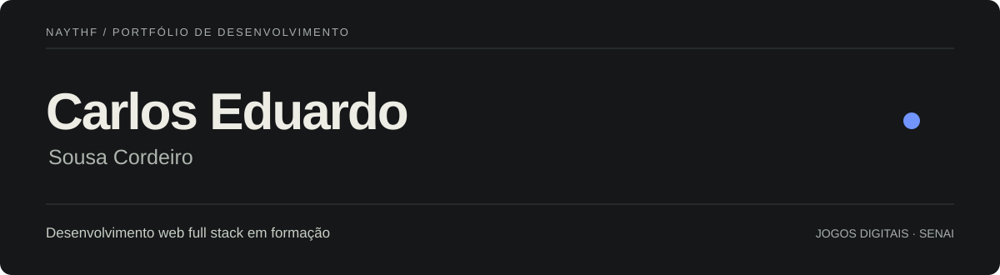

<picture>
  
</picture>

Sou **Carlos Eduardo Sousa Cordeiro**, também conhecido como **Naythf**. Curso Técnico em Jogos Digitais no SENAI e desenvolvo aplicações web e jogos, com foco profissional em **desenvolvimento web full stack**.

Gosto de participar de toda a construção: organizar a interface, programar as funcionalidades e integrar os dados. Busco uma oportunidade de estágio para contribuir em equipe e continuar aprendendo.

### Projetos em destaque

#### Halloween da Eclipse

Plataforma de ingressos desenvolvida para o evento da equipe Eclipse Produções, da qual fiz parte. Atuei no **front-end e no back-end**, incluindo integração com Supabase, fluxo de pedidos, aprovação manual de comprovantes Pix e painel administrativo com validação de ingressos e check-in.

**Tecnologias:** Next.js, React, TypeScript, CSS, Supabase e Vercel.  
**Status:** projeto concluído; evento realizado e vendas encerradas. Código em repositório privado.

#### [Lume Fit](https://github.com/Naythf/Lume-Fit)

Projeto individual de uma **PWA com foco no celular** para organizar rotinas e acompanhar treinos. Reúne criação de rotinas, sessão guiada, registro de séries, cargas e repetições, calendário e gráficos de evolução. Sou responsável pela concepção, interface, desenvolvimento e integração com dados.

**Tecnologias:** HTML, CSS, JavaScript, SQL, Supabase e PostgreSQL.  
**Status:** em desenvolvimento, ainda sem lançamento público. Instalação pelo navegador, persistência local e suporte offline parcial. O gerador de rotinas utiliza catálogo e regras.

#### Endless Adventure

RPG 2D desenvolvido no contexto do Técnico em Jogos Digitais do SENAI. Assumi a **concepção e o desenvolvimento do jogo**, incluindo narrativa, sistemas, interface e integração de recursos visuais e sonoros. Combina exploração, combate por turnos e cooperação local.

**Tecnologias:** Unity, C#, URP 2D e Unity Input System.  
**Status:** versão jogável no Unity, em desenvolvimento e validação. Repositório privado; sem download público confirmado. Assets de terceiros licenciados e creditados no jogo.

### Tecnologias que utilizo

Ferramentas aplicadas nos projetos acima, em diferentes níveis de aprendizado e experiência.

**Interfaces web**

  &nbsp;
  &nbsp;
  &nbsp;
  &nbsp;
  &nbsp;
  

HTML · CSS · JavaScript · TypeScript · React · Next.js

**Dados, jogos e publicação**

  &nbsp;
  &nbsp;
  &nbsp;
  &nbsp;
  &nbsp;
  &nbsp;
  

Supabase · PostgreSQL · Unity · C# · Git · GitHub · Vercel

---

**Estou no começo da minha trajetória profissional.** Estes projetos são meu ponto de partida — quero uma oportunidade para aprender, contribuir e construir o que vem depois.

[Conheça o código público do Lume Fit](https://github.com/Naythf/Lume-Fit) · [Meus repositórios públicos](https://github.com/Naythf?tab=repositories)

### Contato

Para oportunidades profissionais ou para conversar sobre meus projetos: **[naythfol123az@gmail.com](mailto:naythfol123az@gmail.com)**.

<!-- Adicionar o link do portfólio quando estiver público. -->
